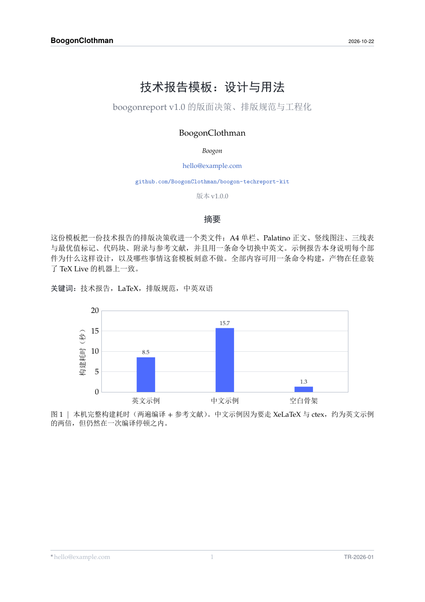

# boogon-techreport-kit

[](https://github.com/BoogonClothman/boogon-techreport-kit/actions/workflows/build.yml)
[](LICENSE)
[](CHANGELOG.md)

一个 LaTeX 技术报告工具包：**一个类文件**装下全部版式决策，中英双语**一条命令**构建。

> A LaTeX template kit for technical reports: one class file for every layout decision,
> one command for both Chinese and English.



## 它解决什么

写技术报告时，真正消耗时间的不是内容，而是每开一份新文档都要重做一遍同样的决定：
页边距、字号、图注标点、表格线、中英混排的断行、数字的写法。这个工具包把这些决定
收进 `boogonreport.cls` 一处，作者只需要关心内容。

- **版式**：A4 单栏、Palatino 正文、首屏品牌带、`图 1 | ...` 竖线图注、三线表、
  代码块、附录与参考文献。
- **双语**：`zh` 选项一次性切换字体管线与本地化文案（摘要、关键词、图、表、附录、
  参考文献），不再手写一串 `\renewcommand`。
- **元信息一处**：`\reportsetup{...}` 同时写入标题块、页眉页脚与 PDF 属性。
- **不会静默出错**：`\keywords` 立即排版；`\appendix` 自动换页；`\cref` 自动输出
  「附录 A」；中文用 pdfLaTeX 编译会直接报错并提示命令。
- **工程化**：`build.ps1` / `Makefile` / GitHub Actions，任何装了 TeX Live 的机器上
  一条命令得到同一份 PDF。

## 快速开始

```powershell
# Windows
.\build.cmd            # 或 .\build.ps1

# macOS / Linux
make
```

产物是 `main-en.pdf` 与 `main-zh.pdf`。第一次构建会生成 `.bbl`，之后改动 `refs.bib`
需要重跑（脚本已自动处理）。

只构建一份：

```powershell
.\build.ps1 -Job main-zh     # 只构建中文
.\build.ps1 -Job starter     # 构建空白骨架
.\build.ps1 -Clean           # 清理中间文件
.\build.ps1 -Watch           # 改一行编译一次
```

> `build.cmd` 只是用 `-ExecutionPolicy Bypass` 调用 `build.ps1`，因为 Windows 默认
> 禁止运行未签名脚本。CI 与 macOS/Linux 直接用 `build.ps1` / `Makefile`。

## 目录结构

```
boogon-techreport-kit/
├── boogonreport.cls          类文件（唯一必须随项目走的文件）
├── main-en.tex               英文示例：用 pdfLaTeX 编译
├── main-zh.tex               中文示例：用 XeLaTeX 编译
├── sections/en/  sections/zh/  两份示例的章节，每章一个文件
├── figures/en/   figures/zh/   图源（TikZ / pgfplots，无外部图片）
├── refs.bib                  参考文献
├── starter/                  空白骨架：复制走就能开工
├── docs/                     快速开始、写作规范、发布清单、迁移、设计说明
├── build.ps1  build.cmd  Makefile
├── .github/workflows/build.yml
└── LICENSE                   MIT
```

## 元信息只写一处

```latex
\documentclass[logo, zh]{boogonreport}

\reportsetup{
  title       = {技术报告模板：设计与用法},
  subtitle    = {可选副标题},
  author      = {BoogonClothman},
  affiliation = {Boogon},
  email       = {hello@example.com},
  link        = {https://github.com/BoogonClothman/boogon-techreport-kit},
  linktext    = {github.com/BoogonClothman/boogon-techreport-kit},
  number      = {TR-2026-01},
  version     = {v1.0.0},
  date        = {2026-10-22},
  wordmark    = {BoogonClothman},
  shorttitle  = {页眉用的短标题},
  keywords    = {技术报告, LaTeX},
}
```

所有键都可省略。省略 `shorttitle` 时页眉用标题；省略 `wordmark` 时用
`BoogonClothman`；`logo` 指向的文件不存在时自动回退到文字标，不会编译失败。

## 类选项

| 选项 | 作用 |
|---|---|
| `zh` | 中文报告：切字体管线、题注、交叉引用文案（**需 XeLaTeX**） |
| `logo` / `nologo` | 首屏是否显示品牌带（默认显示） |
| `times` | 正文与数学换成 Times 家族 |
| `numeric` | 参考文献改为数字引用 `[1]` |
| `nonumbering` | 章节不编号，适合白皮书 |
| `leftalign` | 标题块左对齐（默认居中） |
| `draft` | 行号 + `\todo{}` / `\fixme{}` 可见 |
| `fandol` | 中文用 Fandol 字体集（跨平台可编译） |
| `winfonts` / `macfonts` | 中文用系统字体（更好看，但依赖本机） |

## 常用命令

```latex
\keywords{...}        % 关键词：放在摘要内或摘要后都能正常排版
\secref{sec:x}        % 中文「第 3 节」，英文「section 3」
\cref{fig:x}          % 中文「图 1」，英文「figure 1」
\appref{app:x}        % 「附录 A」
\best{62.4}           % 自最优值加粗
\second{61.0}         % 次优值下划线
\todo{补消融}          % 仅 draft 选项下可见
\fixme{数字待核}       % 页边批注，仅 draft
```

## 中文与字体

中文必须用 XeLaTeX（类里会检查并报错提示）。字体集二选一：

- `fandol`：TeX Live 自带，任何机器都能编，CI 用它；代价是字形偏细、PDF 里中文
  无法复制。
- `winfonts` / `macfonts`：用系统字体，好看且可复制，但换机器可能编不了。

个人机器想要好看就用系统字体，出成品给 CI 就用 Fandol。这是明确的取舍，不是疏漏。

## 迁移到已有项目

**方式 A（最简单）**：把 `boogonreport.cls` 与 `starter/` 拷进项目，改元信息与章节。

**方式 B（放子目录）**：`\documentclass{techreport/boogonreport}`，`\input` 同理。

**方式 C（TEXINPUTS）**：不想改路径时

```powershell
$env:TEXINPUTS = ".\techreport;" + $env:TEXINPUTS
```

详见 [docs/adoption.md](docs/adoption.md)。

## 文档

| 文档 | 内容 |
|---|---|
| [docs/quickstart.md](docs/quickstart.md) | 十分钟出一份报告 |
| [docs/style-guide.md](docs/style-guide.md) | 摘要、数字、图表、引用的写法 |
| [docs/release-checklist.md](docs/release-checklist.md) | 发布前逐项检查 |
| [docs/adoption.md](docs/adoption.md) | 迁移、换字体、加定理环境、换会议模板 |
| [docs/design.md](docs/design.md) | 为什么这样设计，以及刻意不做什么 |

## 版本与许可

- 版本：见 [CHANGELOG.md](CHANGELOG.md)。改版时同时更新 `\reportsetup{version}`、
  CHANGELOG 与 git tag。
- 许可：代码与文档 [MIT](LICENSE)；字体随 TeX Live 分发，按各自 LPPL/GPL 类许可
  嵌入 PDF。
- 不含任何第三方 `.cls` / `.sty`（NeurIPS、ICLR、ACL 等模板请从官方渠道获取）。

## 引用

```bibtex
@misc{boogon-techreport-kit,
  title  = {boogon-techreport-kit: A LaTeX Template for Technical Reports},
  author = {BoogonClothman},
  year   = {2026},
  url    = {https://github.com/BoogonClothman/boogon-techreport-kit}
}
```
